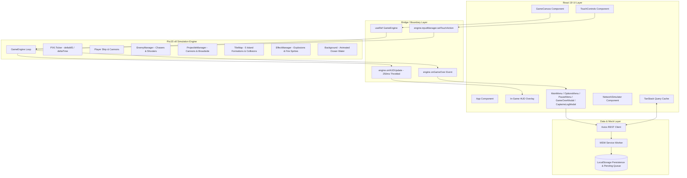
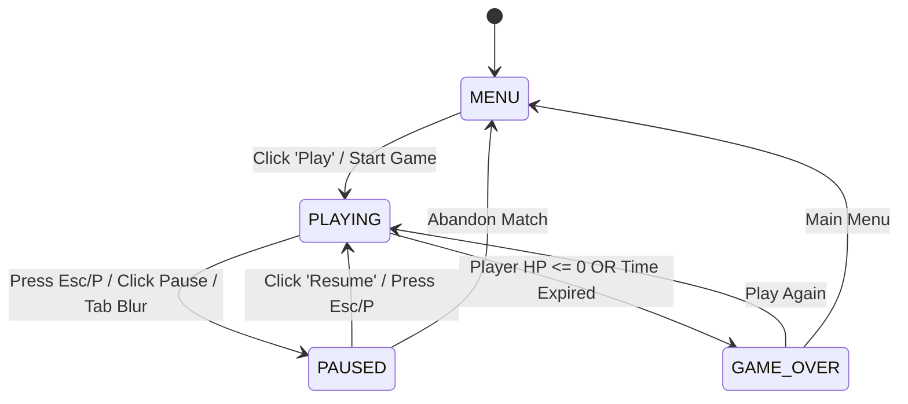

# Architecture Documentation — Pirate Battle

This document outlines the architectural decisions, design patterns, lifecycle management, and mathematical foundations of **Pirate Battle**, a 2D top-down naval combat game built with **React 19**, **TypeScript (Strict Mode)**, **PixiJS v8**, **Tailwind CSS v4**, **TanStack Query v5**, **MSW v2**, and **Playwright**.

---

## 1. High-Level Architecture & Separation of Concerns

The application strictly separates **UI / Application State (React)** from the **High-Performance Simulation & Graphics Loop (PixiJS)**.



---

## 2. Decoupling React UI from PixiJS Game Loop

A common pitfall in web game development is triggering React re-renders on every animation frame (60 FPS), which degrades garbage collection and causes frame drops. 

### Architectural Boundary:
1. **Zero Per-Frame React Re-renders**: The PixiJS ticker executes physics, collisions, particles, and enemy AI at 60 FPS purely within WebGL / Canvas memory.
2. **Throttled HUD Updates (250ms)**: Game metrics (HP, active session countdown, score) are dispatched to React states at a maximum rate of 4 updates per second (250ms interval) using `performance.now()` throttling in `GameEngine.ts`:
   ```ts
   const now = performance.now();
   if (now - this.lastHUDUpdate > 250) {
     const activeDuration = (now - this.startTime - this.totalPausedDuration) / 1000;
     const timeLeft = Math.max(0, this.config.sessionTime - activeDuration);
     this.onHUDUpdate?.(this.enemyManager.score, this.player.health, this.player.maxHealth, timeLeft, this.isGameOver);
     this.lastHUDUpdate = now;
   }
   ```
3. **Floating Health Bars in PixiJS**: Health bars directly attached to combat ships (player and enemies) are rendered directly inside PixiJS `Graphics` containers, moving with the entities without touching the React DOM.

---

## 3. PixiJS Lifecycle & Strict Mode Resilience

React 18 and 19 execute `useEffect` twice on mount during development to detect side-effect leaks. PixiJS v8 initializes asynchronously (`await app.init(...)`), which can lead to canvas duplication or race conditions if not guarded.

### Lifecycle Guarantees:
- **Initialization Mutex (`initPromise`)**: `GameEngine.init(container)` captures its startup promise. If `startGame()` or unmount actions are triggered during asset loading, the engine awaits the promise safely rather than operating on uninitialized managers.
- **Clean Teardown (`destroy()`)**:
  ```ts
  public destroy(): void {
    try {
      if (this.app?.renderer?.canvas && this.app.renderer.canvas.parentNode) {
        this.app.renderer.canvas.parentNode.removeChild(this.app.renderer.canvas);
      }
    } catch { /* Renderer might still be booting */ }
    this.inputManager?.destroy();
    this.projManager?.destroy();
    this.enemyManager?.destroy();
    this.tileMap?.destroy();
    this.background?.destroy();
    this.player?.destroy();
    this.effectManager?.destroy();
    try {
      this.app?.destroy(true, { children: true });
    } catch { /* Safe unmount */ }
    this.isInitialized = false;
    this.initPromise = null;
  }
  ```
- **Container Cleansing**: Prior to mounting, `containerRef.current.innerHTML = ''` ensures zero orphan canvas elements remain.

---

## 4. Time-Based Physics & State Machine

Game state is modeled as a strict finite state machine:



### Time-Delta Integration:
- Movement and rotations scale by PixiJS ticker delta time (`ticker.deltaTime` logical frame scalar and `ticker.deltaMS` millisecond delta), ensuring consistent velocity regardless of 60Hz, 120Hz, or 144Hz monitors.
- **Pause Accumulation**: Pausing freezes the simulation ticker for combat entities while keeping the ocean background waves animated. When the game resumes, `totalPausedDuration += performance.now() - pauseStartTime`, ensuring the match timer does not lose accuracy or penalize the player.

---

## 5. Collision Mathematics & Multi-Island System

Combat entities move continuously across a 1280x720 virtual arena containing 5 distinct island landmasses.

### Circle-to-Circle Collision Resolution:
Circle collision detection is utilized for mathematical stability and CPU efficiency ($O(1)$ Euclidean distance vs complex polygonal raycasting):

$$\text{distance} = \sqrt{(x_1 - x_2)^2 + (y_1 - y_2)^2}$$
$$\text{collision} \iff \text{distance} \le (r_1 + r_2)$$

When a ship collides with an island circle:
1. The collision normal vector is calculated: $\theta = \operatorname{atan2}(y_{\text{ship}} - y_{\text{island}}, x_{\text{ship}} - x_{\text{island}})$.
2. The ship position is clamped along the normal vector:
   $$x_{\text{ship}} = x_{\text{island}} + \cos(\theta) \cdot (r_{\text{island}} + r_{\text{ship}})$$
   $$y_{\text{ship}} = y_{\text{island}} + \sin(\theta) \cdot (r_{\text{island}} + r_{\text{ship}})$$

### Collision Entities:
- **Player vs 5 Islands**: Clamps player position without sticking or passing through land.
- **Enemies vs 5 Islands**: Enemies slide along island perimeters.
- **Projectiles vs 5 Islands**: Projectiles hitting an island are destroyed with a water impact effect.
- **Player Projectiles vs Enemies**: Deal damage; enemy sinks and awards 1 point when HP reaches 0.
- **Enemy Projectiles vs Player**: Reduce player ship HP.
- **Chaser Impact vs Player**: Deals heavy collision damage and triggers an explosion, destroying the Chaser without awarding points.

---

## 6. Remote State, Idempotency & Offline Resilience

Ranking and match history adhere strictly to Section 5 & 6 requirements:

### Data Isolation & Local Sovereignty:
- Ranking and match history store **only battles played on the current client** (no synthetic or hardcoded fake captains).

### Idempotency via `matchId`:
- Each match generates a unique UUID `matchId` upon start.
- Submitting the match to `/api/scores` or `/api/history` checks if `matchId` already exists. Repeated clicks or retries update or return the existing entry rather than duplicating ranking positions.

### Offline Resilience & Pending Score Queue:
If the player finishes a match while offline or under an HTTP 500 error:
1. The pending score payload is saved to `localStorage` under `'pirate_pending_score'`.
2. The UI displays an error notice with a **"Try Again"** button.
3. A `window.addEventListener('online')` listener automatically retries and clears the queue once connection is restored.

---

## 7. Configuration Snapshot & Balance Design

All balance parameters are decoupled in `src/game/config/GameConfig.ts`:
- **Session Duration**: Configurable in Options from **60s to 180s** (default: 120s, step: 30s).
- **Spawn Interval**: Configurable from **1s to 5s** (default: 3s, step: 1s).
- **Player Attributes**: Speed: 3.5, Turn Speed: 0.05 rad/frame, Max HP: 100, Front Cannon Cooldown: 400ms, Broadside Cooldown: 1000ms.
- **Chaser Attributes**: Speed: 2.2, Collision Damage: 35, HP: 40.
- **Shooter Attributes**: Speed: 1.5, Attack Range: 350px, Cannon Cooldown: 1500ms, HP: 60.

Settings are snapshotted at the start of a match so mid-game alterations in options do not mutate active gameplay.

